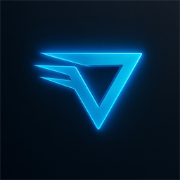
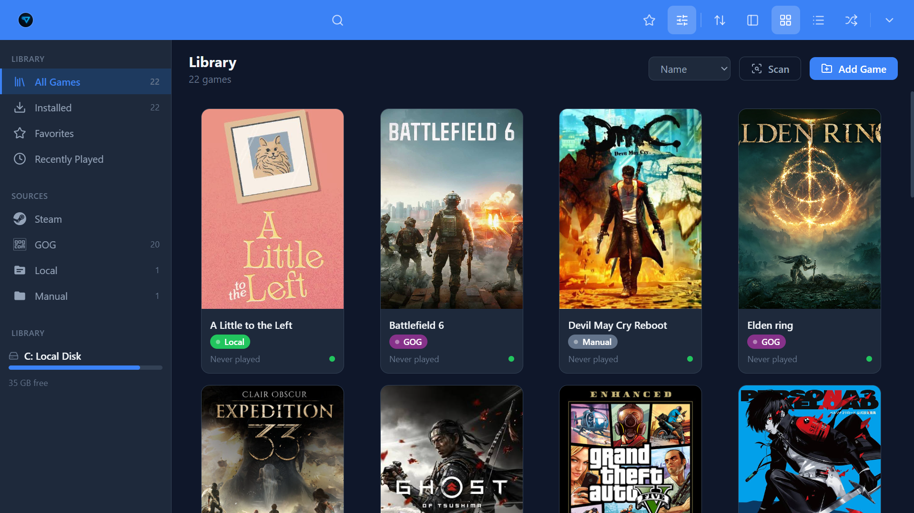
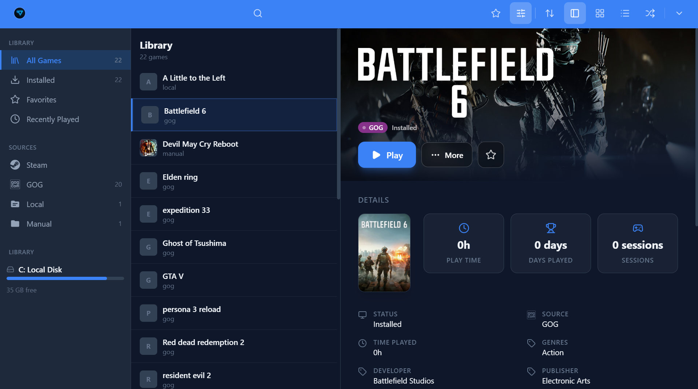
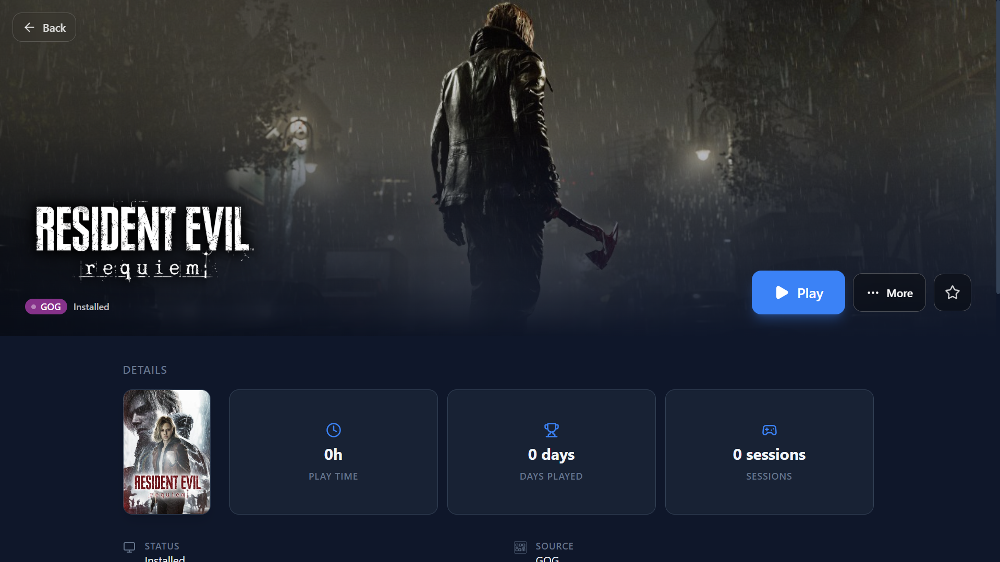

<p align="center">
  
</p>

<h1 align="center">Veylix</h1>

<p align="center">
  <strong>Open-source game library manager for Windows — with a controller-first Console Mode.</strong>
</p>

<p align="center">
  <a href="https://github.com/denniskim2508-rgb/veylix/releases/latest"></a>
  <a href="https://github.com/denniskim2508-rgb/veylix/releases"></a>
  
  
</p>

---

Veylix gathers every game on your PC into one library, fills it with artwork and
metadata, and gives you a second way to browse it — from the couch, with a
controller.

## Screenshots

<p align="center">
  
</p>

<p align="center">
  
  
</p>

## Features

- **Automatic detection** — scans and imports your libraries from Steam, Epic,
  GOG, Xbox, EA, Ubisoft, Battle.net and Rockstar, plus any local folders and
  emulator setups.
- **Rich metadata** — pulls details from IGDB, RAWG, Steam, MobyGames and
  SteamGridDB, with a resolver that fills in whatever is missing.
- **Artwork that looks right** — cover, hero and icon artwork with manual
  overrides, an artwork manager, and web image search across Google, Bing,
  DuckDuckGo and SteamGridDB.
- **Screenshots & trailers** — keep your own screenshot galleries and trailers
  alongside each game.
- **Console Mode** — a full-screen, D-pad-driven interface with a game carousel,
  on-screen button prompts, navigation sounds and wallpaper themes. Built for a
  controller, not a mouse.
- **Emulator support** — DAT databases, ROM scanning and per-emulator profiles.
- **Add-ons** — an extensible add-on catalog for extending sources and features.
- **9 languages** — English, Spanish, French, German, Portuguese (Brazil),
  Russian, Japanese, Korean and Simplified Chinese.
- **Auto-updates** — signed updates delivered straight from GitHub Releases.

## Download

Grab the latest installer from the
[Releases](https://github.com/denniskim2508-rgb/veylix/releases/latest) page:

- `Veylix_<version>_x64-setup.exe` — Windows installer (NSIS)

Once installed, Veylix checks for updates on demand from **Settings → About**.

## Building from source

**Requirements**

- [Node.js](https://nodejs.org/) 20+
- [Rust](https://rustup.rs/) 1.90 or newer
- Microsoft Visual Studio C++ build tools (for the Windows target)

**Run in development**

```bash
git clone https://github.com/denniskim2508-rgb/veylix.git
cd veylix
npm install
npm run tauri dev
```

**Build an installer**

```bash
npm run tauri build
```

## Tech stack

- [Tauri 2](https://tauri.app/) (Rust backend) with an NSIS Windows bundle
- [React 19](https://react.dev/) + [TypeScript](https://www.typescriptlang.org/)
- [Vite](https://vite.dev/) and [Tailwind CSS 4](https://tailwindcss.com/)
- [Zustand](https://zustand-demo.pmnd.rs/) for state management
- [oxlint](https://oxc.rs/docs/guide/usage/linter) for linting

## License

MIT
